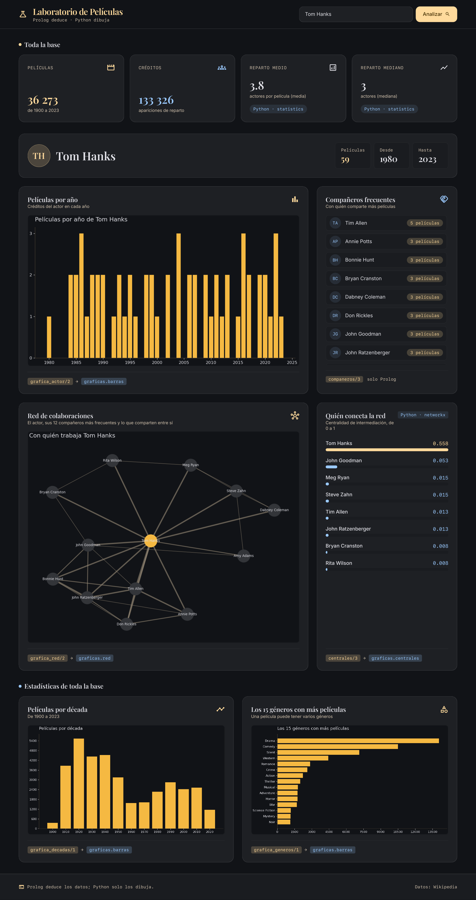

# Prompt para Google Stitch — logicDemo2

Pegar en [stitch.withgoogle.com](https://stitch.withgoogle.com), modo web. Al terminar,
exportar el zip a esta carpeta `design/` para adaptarlo a la API real.

## Prompt

```text
Design a responsive analytics dashboard called "Laboratorio de Películas": a data lab
where a Prolog logic engine deduces the data and Python (matplotlib, networkx) draws
it. All UI text in Spanish. Mobile-first; must look polished on a phone and on a wide
desktop screen. One page, no tabs.

Style: professional data product, dark theme, calm and spacious. Background #111317,
cards #1e2024 with 16px radius and a hairline border, amber #f5b942 as the Prolog
accent and a cool blue #6cb6ff as the Python accent, off-white text #e2e2e8, muted
secondary text. Inter for UI, a serif display (Playfair Display) for the page title
and the actor name. Generous padding (24px in cards), 24px gaps, clear hierarchy.
No stock photos, no posters, no user avatar menu.

IMPORTANT about charts: every chart is a ready-made dark PNG image (background
#111317, amber bars) served by the backend. Do not draw charts with HTML or CSS.
Show each chart as an  inside a card with a fixed aspect ratio (9:5 for bar
charts, 9:7 for the network), object-fit contain, a skeleton shimmer while loading,
and never let the image overflow or get cropped.

Layout, top to bottom:

1. Sticky header: title "Laboratorio de Películas", subtitle "Prolog deduce · Python
   dibuja", and on the right a compact search field (placeholder "Tom Hanks") with a
   button "Analizar".

2. KPI row "Toda la base": four stat tiles — "36 273 películas", "133 326 créditos",
   "3.8 actores por película (media)", "3 actores (mediana)". The last two carry a
   small blue tag "Python · statistics".

3. Actor section. A header with an initials avatar, the actor name in serif
   ("Tom Hanks") and three stat tiles: "59 películas", "Desde 1980", "Hasta 2023".
   Below, a two-column grid on desktop (stacked on mobile):
   - Left, wide card "Películas por año" with the bar chart image.
   - Right, narrow card "Compañeros frecuentes": a ranked list of 12 rows, each with
     initials avatar, name, and a count pill ("Tim Allen · 5 películas"). Rows are
     clickable and load that actor.
   Then a second two-column grid:
   - Left, wide card "Red de colaboraciones" with the network image (9:7).
   - Right, narrow card "Quién conecta la red" with tag "Python · networkx": a ranked
     list with a thin horizontal progress bar per actor showing a score from 0 to 1
     ("Tom Hanks 0.558", "John Goodman 0.053", "Meg Ryan 0.015").
   Include an error state for this section: "No hay nadie con ese nombre en la base".

4. Section "Toda la base": two cards side by side on desktop, stacked on mobile —
   "Películas por década" and "Los 15 géneros con más películas", each with its chart
   image.

5. Every chart card has a footer strip "Cómo se hizo" with two small code chips joined
   by an arrow: an amber chip with the Prolog rule (for example
   "grafica_actor/2") → a blue chip with the Python function (for example
   "graficas.barras"). Monospace, small, unobtrusive.

6. Footer: "Prolog deduce los datos; Python solo los dibuja." and "Datos: Wikipedia".

Plain HTML and CSS (Tailwind is fine), no JavaScript frameworks. Accessible contrast,
visible focus states, minimum 44px touch targets.
```

## Resultado



## Datos que la página recibe

| Ruta | Responde |
|---|---|
| `/api/base` | `{peliculas, creditos, reparto_media, reparto_mediana}` |
| `/api/actor?nombre=` | `{actor, primer, ultimo, peliculas, companeros[{actor, peliculas}], centrales[{actor, puntaje}]}`; 404 si no existe |
| `/grafica/actor?nombre=` | PNG 1080×600, películas por año |
| `/grafica/red?nombre=` | PNG 1080×840, red de colaboraciones |
| `/grafica/decadas` | PNG 1080×600 |
| `/grafica/generos` | PNG 1080×600 |
